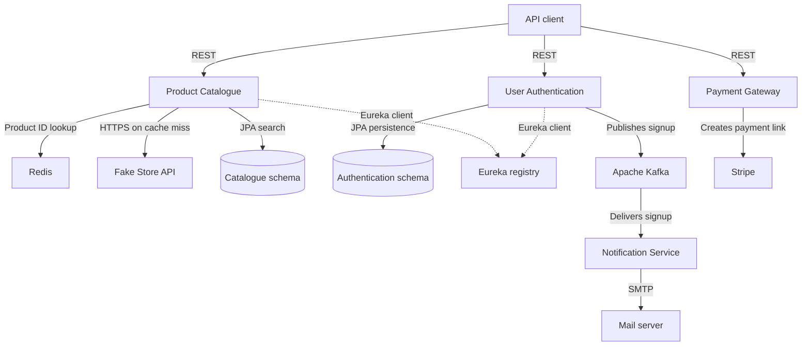

# Java Spring Boot Microservices Platform

A Java 17 and Spring Boot portfolio project that models common e-commerce workflows. Clients can look up products, search the catalogue, create accounts, sign in, and request hosted payment links. Signup also initiates an asynchronous email notification.

This repository documents five independently maintained services. The architecture and API examples reflect the source on their default branches.

## Services

| Service | Responsibilities |
| --- | --- |
| [Product Catalogue](https://github.com/Khushboo-Chopra/ProductCatalogue) | Looks up products through Fake Store API and caches results in Redis. Searches its MySQL catalogue by product name with pagination and sorting. |
| [User Authentication](https://github.com/Khushboo-Chopra/UserAuthenticationService) | Handles signup, login, BCrypt password hashing, JWT issuance and validation, and signup event publishing. |
| [Notification Service](https://github.com/Khushboo-Chopra/NotificationService) | Consumes Kafka signup events, deserializes email payloads, and submits messages to an SMTP server using JavaMail. |
| [Payment Gateway](https://github.com/Khushboo-Chopra/PaymentGateway) | Creates Stripe-hosted payment links. The repository also contains a Razorpay adapter. The current provider selection is Stripe. |
| [Service Discovery](https://github.com/Khushboo-Chopra/ServiceDiscovery) | Runs a Netflix Eureka registry. Catalogue and authentication are configured as Eureka clients. |

## Architecture



### REST and service discovery

Clients call the catalogue, authentication, and payment services directly over HTTP. The catalogue calls Fake Store API over HTTPS for an uncached product. The alternate JPA-backed catalogue implementation includes a load-balanced `RestTemplate` call to the authentication service's user endpoint. The default product controller selects the Fake Store implementation, so that internal call sits outside the default request path.

### Kafka signup flow

The authentication service serializes an email payload and submits it to the `signup` topic. The notification service consumes it with the `emailService` consumer group and sends the message via SMTP. The producer call currently precedes the user save. Publishing after commit would keep failed signups from triggering emails.

### JWT authentication

Signup hashes passwords with BCrypt. Login checks the password, signs a JWT with JJWT, persists a session, and returns the token in the `Set-Cookie` response header. The token validation endpoint checks the submitted JWT. The Spring Security filter chain currently permits all requests. JWT-based endpoint authorization and role enforcement are future work.

### Redis and MySQL

For product lookup by ID, Product Catalogue checks the Redis `PRODUCTS` hash first. On a miss it fetches the product from Fake Store API and stores the result. The cache path has no explicit expiration or write invalidation.

| MySQL schema | Service data |
| --- | --- |
| `productcatalogservice` | Catalogue products and categories. The search endpoint reads products through Spring Data JPA. |
| `userauthservice` | Users, roles, and authentication sessions. |

Both JPA services use Hibernate schema updates. Start with local schemas and seed a matching product before testing database-backed search.

### Stripe

`POST /payment` delegates to Stripe to create a hosted payment link. The current Stripe implementation uses USD and passes the supplied amount as the Stripe unit amount. The webhook endpoint accepts and logs the request body. Signature verification and payment-state updates are future work.

## Technology stack

| Area | Technologies |
| --- | --- |
| Application and build | Java 17, Spring Boot, Spring MVC, Maven Wrapper, Lombok |
| Persistence and caching | Spring Data JPA, Hibernate, MySQL, Spring Data Redis |
| Authentication | Spring Security, BCrypt, JJWT |
| Messaging and discovery | Apache Kafka, Spring Kafka, Spring Cloud Netflix Eureka |
| External integrations | Fake Store API, JavaMail and SMTP, Stripe Java SDK, Razorpay Java SDK |
| Testing | JUnit, Mockito, Spring MockMvc |

## Run locally

1. Install a JDK for Java 17 and clone the service repositories you want to run. Use each service's Maven Wrapper from its own root.
2. Start MySQL on port 3306. Create `productcatalogservice` and `userauthservice`, and give your local MySQL user access to the appropriate schema. Set `SPRING_DATASOURCE_USERNAME` and `SPRING_DATASOURCE_PASSWORD` for each JPA service.
3. Start Redis on port 6379 for catalogue lookups and Kafka on port 9092 for the signup flow. Set `SPRING_KAFKA_BOOTSTRAP_SERVERS` for both authentication and notification if the broker runs elsewhere.
4. Configure the notification service for a local or test SMTP server. Its SMTP settings are currently defined in code. Use Stripe test credentials and local configuration overrides for payment. The payment app also has Razorpay client configuration.
5. Start Eureka, then launch each required service in a separate terminal. The example ports below keep the processes from competing for port 8080.

| Service | Command from the service root |
| --- | --- |
| Service Discovery | `./mvnw spring-boot:run` |
| Product Catalogue | `SERVER_PORT=8080 ./mvnw spring-boot:run` |
| User Authentication | `SERVER_PORT=8081 ./mvnw spring-boot:run` |
| Notification Service | `SERVER_PORT=8082 ./mvnw spring-boot:run` |
| Payment Gateway | `SERVER_PORT=8083 ./mvnw spring-boot:run` |

Eureka is configured for port 8761. Use `mvnw.cmd` and the corresponding environment-variable syntax on Windows. The platform currently has no shared Docker Compose setup. The startup steps are based on source configuration and the full sequence still needs end-to-end verification.

## API examples

| Service | Route | Request |
| --- | --- | --- |
| Catalogue | `GET /products/{id}` | Positive numeric product ID. |
| Catalogue | `POST /search` | JSON with `query`, zero-based `pageNumber`, `pageSize`, and `sortParamList`. |
| Authentication | `POST /auth/signup` | JSON with `name`, `email`, and `password`. |
| Authentication | `POST /auth/login` | JSON with `email` and `password`. |
| Authentication | `POST /auth/validateToken` | JSON with `token`. |
| Payments | `POST /payment` | JSON with `amount`, `orderId`, `phoneNumber`, `name`, and `email`. Use provider test mode. |

```bash
curl -i http://localhost:8080/products/1

curl -i http://localhost:8080/search \
  -H 'Content-Type: application/json' \
  -d '{"query":"Demo Product","pageNumber":0,"pageSize":10,"sortParamList":[{"paramName":"price","sortOrder":"ASC"}]}'

curl -i http://localhost:8081/auth/login \
  -H 'Content-Type: application/json' \
  -d '{"email":"demo@example.com","password":"local-demo-password"}'
```

For search, seed a product named `Demo Product` in the local catalogue schema. For login, create the demo account through `POST /auth/signup` first.

## Build and test

From each service root:

```bash
./mvnw test
./mvnw clean package
```

Product Catalogue contains JUnit tests with Mockito and MockMvc for controller behavior, plus JPA repository tests. The other four services contain application-context smoke tests. Some tests may require local dependencies and configuration. Current build, test, and cross-service results have yet to be verified in a clean environment.

## Known limitations and next steps

| Current scope | Next step |
| --- | --- |
| Some CRUD methods in the default product service are unfinished. | Complete CRUD behavior and define cache expiration and invalidation. |
| JWT issuance and validation are implemented. Endpoint authorization is pending. | Enforce token and role checks and cover allowed and denied requests in tests. |
| Signup submits its Kafka event before persisting the user. | Publish after commit and handle retry and duplicate delivery. |
| The Stripe webhook logs incoming payloads. | Verify webhook signatures and persist payment-state changes. |
| Local setup is per service, with no central Docker Compose file and no verified end-to-end run. | Add repeatable infrastructure setup, OpenAPI documentation, and cross-service integration tests. |
